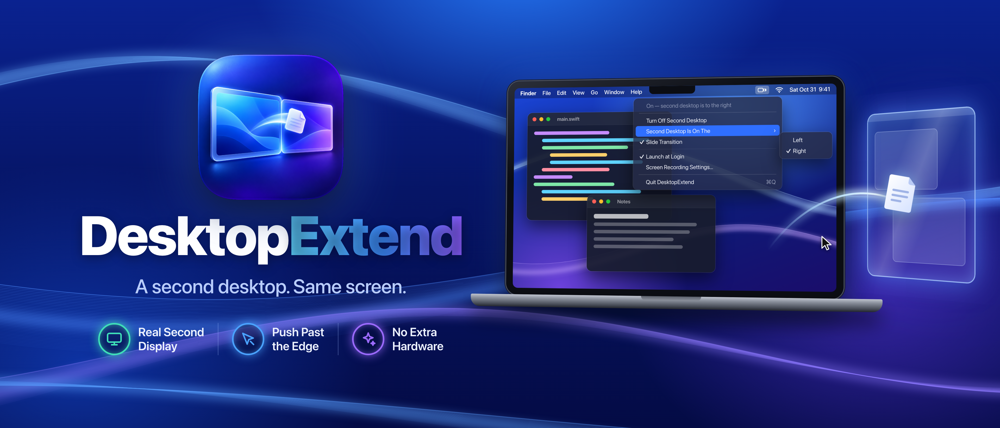

# DesktopExtend



Your Mac's screen is only so big. DesktopExtend adds a second desktop beside it, and macOS treats it as a real second monitor.

You see one desktop at a time. Push your cursor past the edge of the screen and the view slides across to the other one. Push back and you're home.

It's a real display, not a Space. Drag windows onto it, full-screen apps on it, and give it its own menu bar. Window positions stay put between switches, just like on a physical monitor.

Sharp, fast, native. The second desktop runs at your screen's exact resolution, so text stays crisp. Clicks, drags, keyboard focus and window management all work the way they normally do, because the cursor really is on that display.

Out of the way. DesktopExtend lives in the menu bar with no Dock icon. Choose which side the second desktop sits on, turn the slide animation on or off, and have it start at login.

Features
- A second desktop that macOS sees as a real monitor
- Push past the screen edge to slide between desktops
- Put it on the left or right side of your screen
- Slide transition or an instant cut
- Full-screen apps, its own menu bar, windows that stay where you left them
- Recovers on its own after sleep
- Removes the extra display when you quit, so no leftover monitor
- No Accessibility permission needed

Requirements: macOS 14 Sonoma or later. DesktopExtend needs Screen Recording permission to show the second desktop on your screen. It asks on first launch and turns on as soon as you grant it.

---

## How it works

Four pieces, none of which require the cursor to be faked or intercepted:

1. **A real virtual display.** `CGVirtualDisplay` (private CoreGraphics)
   registers a display with the WindowServer that exactly matches your built-in
   panel — same point size, same backing scale. macOS genuinely believes a
   second monitor is attached.

2. **Placed flush against the physical display.** `CGConfigureDisplayOrigin`
   puts it edge-to-edge, sharing the full height. Because the two displays are
   actually adjacent in the arrangement, **macOS moves the cursor between them
   natively** — there is no event tap, no cursor warping, and therefore no
   Accessibility permission.

3. **Mirrored back onto your panel.** ScreenCaptureKit streams the virtual
   display's contents into a click-through overlay window. Frames arrive as
   IOSurfaces and are handed straight to a `CALayer`, so pixels never touch the
   CPU. Because the virtual display matches the panel exactly, the mirror lands
   1:1 with no resampling — text stays sharp.

4. **A cursor watcher drives the transition.** The cursor position is polled at
   120 Hz (readable without any entitlement) to detect which display it is on,
   and the overlay slides in or out.

The key idea is that **the cursor is genuinely on the second display** whenever
you are using it. The overlay is a passive, click-through mirror on the panel
you happen to be looking at, so clicks, drags, keyboard focus, and window
management all work natively.

### The slide

The physical desktop cannot actually move, so the push transition stands it in
with a still captured just before the crossing (warmed as the cursor comes
within 200 pt of the edge). The overlay hosts a container layer twice the panel
width — live mirror in one half, still in the other — and slides it across.

If no still is ready, the mirror simply slides over the real desktop instead.
Turn the effect off entirely with **Slide Transition** in the menu.

## Building

```bash
./Scripts/build-app.sh
open build/DesktopExtend.app
```

It runs as a menu-bar item with no Dock icon.

`build-app.sh` adapts to the certificate you give it:

| `DE_CODESIGN_IDENTITY` | Signing | Output |
| --- | --- | --- |
| unset (ad-hoc) | plain | `.app` |
| `Apple Development: …` | plain, stable | `.app` |
| **`Developer ID Application: …`** | **hardened runtime + secure timestamp** | **`.app` + `.dmg`** |

A Developer ID certificate is taken as intent to distribute, so the build is
signed the way notarization requires and a disk image is produced alongside the
app. The image is *not* notarized — run `Scripts/release.sh` for that. Set
`DE_SKIP_DMG=1` to suppress it.

Certificate detection accepts either the full certificate name or the SHA-1
fingerprint that `security find-identity` prints.

## Screen Recording permission

Mirroring is screen capture as far as macOS is concerned, so the app needs
**Screen & System Audio Recording** permission. On first launch it asks, shows
"Waiting for Screen Recording permission" in its menu, and **enables itself
automatically the moment you grant it** — no restart needed.

### Keeping the permission across rebuilds

macOS ties the grant to the code signature. An ad-hoc signature (the default
here) changes on every build, so **each rebuild requires re-granting**. To avoid
that during development, sign with a stable identity:

```bash
security find-identity -v -p codesigning          # pick one
DE_CODESIGN_IDENTITY="Apple Development: You (TEAMID)" ./Scripts/build-app.sh
```

Any stable identity works, including a self-signed certificate created in
Keychain Access via *Certificate Assistant → Create a Certificate* (type: code
signing).

## Menu options

| Option | Meaning |
| --- | --- |
| Turn On/Off Second Desktop | Creates or tears down the virtual display |
| Second Desktop Is On The → Left / Right | Which edge to push against. Defaults to **Left** |
| Slide Transition | Slide across (on) vs. straight cut (off) |

## Distribution

DesktopExtend **cannot ship on the Mac App Store** — it depends on the private
`CGVirtualDisplay` API, which App Review rejects under guideline 2.5.1, and
there is no public API for creating a virtual display to rewrite toward. The
supported path is Developer ID + notarization, which is how every app in this
category ships.

```bash
DE_SIGN_IDENTITY="Developer ID Application: You (TEAMID)" ./Scripts/release.sh
```

The script builds, signs with the hardened runtime and a secure timestamp,
notarizes the app, staples the ticket, then builds a disk image from the
stapled app and notarizes that too.

`build-app.sh` and `release.sh` share their signing and packaging logic via
`Scripts/common.sh`. The difference is only the Apple round-trip: `build-app.sh`
stops at a signed `.dmg`, `release.sh` notarizes and staples it.

Notarization usually takes a few minutes, but a first submission from a newly
issued Developer ID can take half an hour. The script submits and polls as
separate steps rather than using `notarytool --wait`, which aborts the whole run
on a transient network error and loses track of an upload that already
succeeded. The submission id is recorded against the app's cdhash, so re-running
after an interruption resumes the same submission instead of re-uploading — and
refuses to reuse it if the binary changed in between.

### One-time setup

**1. A Developer ID Application certificate.** This is the only certificate
type notarization accepts. `Apple Development` (local testing) and
`Apple Distribution` (App Store) are both rejected — the script refuses them up
front rather than failing thirty seconds into an upload.

Create one at
[developer.apple.com → Certificates](https://developer.apple.com/account/resources/certificates)
→ **+** → **Developer ID** → **Developer ID Application**. It requires an Apple
Developer Program membership and the Account Holder or Admin role. Download and
double-click the `.cer`, then confirm:

```bash
security find-identity -v -p codesigning | grep "Developer ID Application"
```

**2. Notarization credentials**, stored once in the keychain. The password is an
app-specific password from [appleid.apple.com](https://appleid.apple.com), not
your Apple ID password:

```bash
xcrun notarytool store-credentials "DesktopExtend" \
    --apple-id "you@example.com" \
    --team-id "YOURTEAMID" \
    --password "abcd-efgh-ijkl-mnop"
```

### Testing the pipeline without a certificate

Everything except the Apple round-trip runs offline:

```bash
DE_SKIP_NOTARIZE=1 DE_SIGN_IDENTITY="-" ./Scripts/release.sh
```

This builds, ad-hoc signs with the hardened runtime, verifies, and produces a
DMG — useful for confirming the mechanics before the certificate exists.

| Variable | Meaning |
| --- | --- |
| `DE_SIGN_IDENTITY` | Signing identity. Auto-detected if exactly one Developer ID Application cert is installed |
| `DE_KEYCHAIN_PROFILE` | notarytool profile name (default `DesktopExtend`) |
| `DE_SKIP_NOTARIZE=1` | Sign and package only |
| `DE_SKIP_DMG=1` | Skip disk image creation |

## Notes and limitations

- **`CGVirtualDisplay` is a private API.** It is resolved at runtime via
  `objc_getClass`, so if a future macOS removes it the app reports
  "Unsupported on this macOS build" rather than failing to launch. The private
  surface is four Objective-C classes, confined to
  `Sources/CVirtualDisplay/CVirtualDisplay.m`; every other API the binary
  imports is public. See [Distribution](#distribution) for what this means for
  shipping.
- **Sleep parks the mirror and wake rebuilds it.** ScreenCaptureKit does not
  survive a sleep cycle — it comes back attached but silent, with no error
  reported, which showed up as a second desktop whose cursor had stopped
  moving. The stream is now stopped on `willSleep`/`screensDidSleep` and
  restarted on wake, retrying while the WindowServer re-registers displays. If
  the virtual display itself did not survive, it is recreated. A watchdog
  catches the same freeze from any other cause: no frames while the cursor is
  visibly moving across the mirror means the stream is dead.
- **The display is torn down on quit** (including on `SIGINT`/`SIGTERM`), so a
  crash or force-quit will not leave a phantom monitor behind.
- The second desktop's resolution tracks the display it was created against.
  Changing your panel's resolution re-syncs the arrangement automatically.
- The overlay sits above the menu bar and full-screen apps, and sets
  `sharingType = .none` so it never appears in other apps' screen recordings.

### Debugging

```bash
log stream --level info --predicate 'subsystem == "com.port21.DesktopExtend"'
```

## License

MIT — see [LICENSE](LICENSE).
